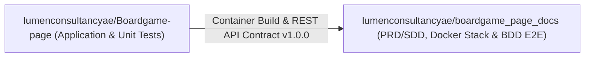

# Product Requirements Document (PRD) — Boardgame Hub

## 1. Product Vision & Scope

**Boardgame Hub** is a web application designed for tabletop gamers and community hosts to catalog the board games they play, log play sessions, curate and share filtered game lists, generate visual rule summaries and interactive setup/turn-order flowcharts for friends, share formatted game cheat-sheets and lists directly on WhatsApp, and track boardgame events across the United Arab Emirates (UAE).

### Target User Personas

| Persona | Primary Goal | Key Workflows |
| :--- | :--- | :--- |
| **Game Night Host** | Organize game nights, track owned/wishlist games, and record play sessions and winners. | Add games, filter by player count and playtime, share candidate game lists on WhatsApp, log session scores. |
| **Visiting Friend / Learner** | Understand how to set up a game, what happens on a turn, and how to win without reading a 24-page rulebook. | View interactive SVG turn-order flowchart, inspect phase details, read setup checklist and WhatsApp rule cheat-sheet. |
| **UAE Community Organizer** | Discover and promote tabletop meetups, café nights, and tournaments across Dubai, Abu Dhabi, Sharjah, and other Emirates. | Browse events by Emirate, publish new community meetups, track seat RSVPs, share event invites on WhatsApp. |

---

## 2. Day-0 / Cold-Start & Onboarding Operational Use Cases

1. **Zero-Data / Empty-Catalog Cold Start (`BOARDGAME_SEED_DEFAULTS=false`)**:
   - **Given** a freshly deployed instance started with zero pre-seeded records (`0` games, `0` play sessions, `0` UAE events),
   - **When** the host opens the application landing view,
   - **Then** the Collection Catalog displays an actionable empty-state prompt guiding the user to click **+ Add Game** to create their first game entry, the Analytics dashboard renders zeroed baseline metrics (`0` games, `0.0` average complexity) without division-by-zero errors, and the UAE Events tab invites organizers to click **+ Host UAE Boardgame Event**.
2. **Curated Starter Bootstrap (`BOARDGAME_SEED_DEFAULTS=true`)**:
   - **Given** a new deployment with default seeding enabled,
   - **When** the database initializes for the first time,
   - **Then** the migration runner idempotently seeds 6 popular gateway and strategy board games (*Catan*, *Wingspan*, *Azul*, *Dune: Imperium*, *Ticket to Ride: Europe*, *Terraforming Mars*) complete with setup checklists and turn-phase diagrams, 4 sample play sessions, and 4 upcoming UAE boardgame meetups across Dubai, Abu Dhabi, and Sharjah.

---

## 3. Functional Requirements & Acceptance Use Cases

### FR-1: Board Game Collection Catalog & Play Session Tracker (`BOA-2`)
- **Use Case 1.1 — Filter & Browse Collection**:
  - `Given` a user with owned, wishlist, and played board games, `When` they filter by status (`Owned`), player count (`4 Players`), or maximum complexity (`<= 3.2`), `Then` only matching games are displayed and the URL state reflects the active view.
- **Use Case 1.2 — Add New Board Game**:
  - `Given` the **+ Add Game** drawer is open, `When` the user submits a valid title, player range, playtime, complexity weight, mechanics, and setup steps, `Then` the game is persisted and immediately selectable in the catalog and rule diagram selector.
- **Use Case 1.3 — Log Play Session**:
  - `Given` a game in the collection, `When` the user logs a play session with players, winner, duration, café location, and notes, `Then` the session appears at the top of the Recent Play Log and the game's `play_count` increments by `1`.

### FR-2: Visual Rule Summaries & Interactive Turn-Order Diagrams (`BOA-3`)
- **Use Case 2.1 — Interactive Flowchart & Phase Inspector**:
  - `Given` a selected board game in the **Rule Summaries & Diagrams** view, `When` the user views the SVG flowchart and clicks a turn-phase node, `Then` the node highlights and the Phase Inspector displays the detailed rules for that step alongside the 3-column Setup Checklist, Turn Phases, and Scoring & Teach Tips.
- **Use Case 2.2 — Exportable Mermaid v11 Diagram**:
  - `Given` any board game in the catalog, `When` the user expands the Mermaid syntax disclosure, `Then` a valid Mermaid v11 `flowchart LR` definition with quoted labels is provided for embedding in external markdown or wikis.

### FR-3: Shareable Curated Game Lists & Collection Analytics Graphs (`BOA-4`)
- **Use Case 3.1 — Collection Analytics Graphs**:
  - `Given` an active boardgame catalog, `When` the user opens **Graphs & Analytics**, `Then` the application displays KPI summary cards and visual bar graphs for Complexity Weight Distribution (Light / Medium / Heavy), Player-Count Coverage (`1P` to `5P+`), Core Mechanics Frequency, and the Most-Played Games Leaderboard.

### FR-4: UAE Boardgame Events & Community Meetups Tracker (`BOA-5`)
- **Use Case 4.1 — Emirate Filtering & Seat RSVP**:
  - `Given` community events across Dubai, Abu Dhabi, and Sharjah, `When` a player filters by Emirate (`Dubai`) and clicks **RSVP (+1 Seat)** on an open event, `Then` only Dubai events are listed and the event's confirmed RSVP counter increments by `1` up to `max_players`.
- **Use Case 4.2 — Host New UAE Event**:
  - `Given` a community organizer opens **+ Host UAE Boardgame Event**, `When` they submit an event title, UAE Emirate, venue, date/time (GST), capacity, and featured games, `Then` the event is published to the UAE Events board.

### FR-5: WhatsApp Sharing Integration (`BOA-6`)
- **Use Case 5.1 — One-Click WhatsApp Summary & Deep Links**:
  - `Given` a game rule summary, a filtered game list, or a UAE boardgame event, `When` the user clicks the WhatsApp share button, `Then` the WhatsApp Share Drawer opens with a formatted message preview, a one-click **Copy Formatted Text** action, and an encoded `https://wa.me/?text=...` deep link.

---

## 4. Multi-Repository Ecosystem & Dependency DAG

1. **Release Ordering**: Changes to domain schemas or API routes are implemented and unit-tested first in `lumenconsultancyae/Boardgame-page`, followed by specification, `docker-compose.yml`, and BDD E2E scenario updates in `lumenconsultancyae/boardgame_page_docs`.
2. **Version Compatibility**: Both repositories track semantic version `1.0.0` (`VERSION` file and `/api/v1/health` payload).
