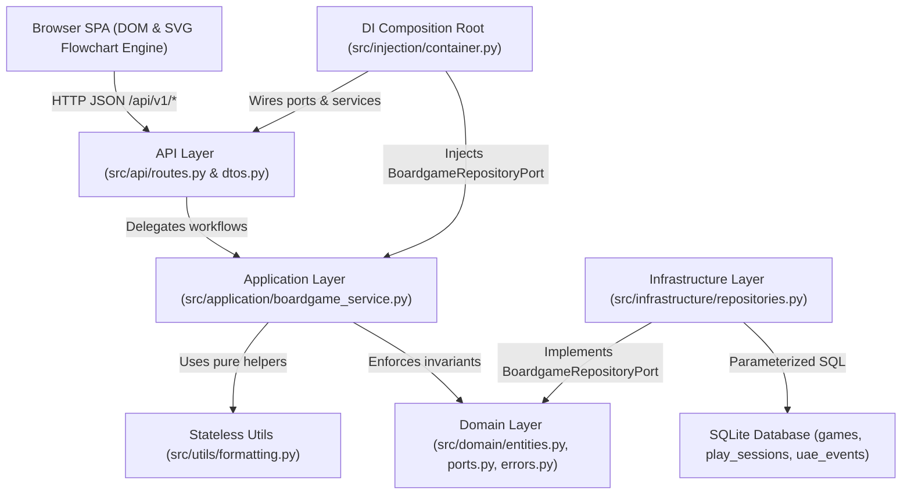
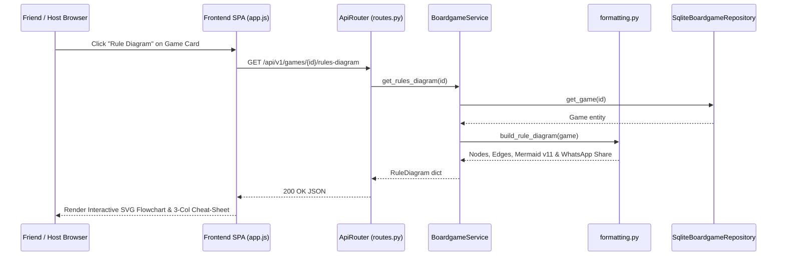

# Software Design Document (SDD) — Boardgame Hub

## 1. High-Level Architecture

Boardgame Hub is architected as a strictly layered Python 3.11+ web service (`src/domain`, `src/application`, `src/infrastructure`, `src/api`, `src/config`, `src/utils`, `src/injection`) serving both a RESTful JSON API (`/api/v1/*`) and a zero-build, XSS-safe single-page frontend (`/`). Persistence is backed by SQLite with idempotent schema migrations and transactional play-count updates.



---

## 2. Phase-by-Phase Technical Breakdown

### Phase 1: Request Parsing & Query Validation (`src/api/routes.py`, `src/api/dtos.py`)
1. `ApiRouter.dispatch(method, raw_path, json_body)` splits the request URL into a normalized path and query string.
2. For collection list and WhatsApp list endpoints, `parse_game_filter_query(query_string)` parses `status`, `players`, `max_playtime`, `max_complexity`, `mechanic`, `search`, `include_archived`, and `title`:
   - If `players`, `max_playtime`, or `max_complexity` contains non-numeric characters, a `ValidationError` (`ErrorCode.VALIDATION_ERROR`) is raised immediately and translated by `format_error_envelope()` into an HTTP `400` response.
3. Static routes (`/`, `/styles.css`, `/app.js`) read UTF-8 assets from `src/api/static/`. Unmatched routes raise `NotFoundError` (`HTTP 404`).

### Phase 2: Application Workflow Orchestration (`src/application/boardgame_service.py`)
1. **Collection Management (`list_games`, `create_game`, `update_game`, `delete_game`)**:
   - Validates game status against `VALID_GAME_STATUSES` (`owned`, `wishlist`, `played`), enforces `1 <= min_players <= max_players`, `5 <= min_playtime_mins <= max_playtime_mins`, `1.0 <= complexity_weight <= 5.0`, and `1.0 <= rating <= 10.0`.
   - Generates deterministic slug + short-UUID identifiers (`game-<slug>-<hex6>`) and UTC ISO-8601 timestamps.
2. **Play Session Logging (`log_session`)**:
   - Verifies the target `game_id` exists via `get_game(game_id)` (raising `NotFoundError` if absent).
   - Normalizes comma-separated or array player lists, defaults `winner` to the first listed player when omitted, persists the `PlaySession`, and atomically increments `games.play_count = play_count + 1` in the same SQLite transaction.
3. **UAE Events & Capacity-Guarded RSVPs (`list_events`, `create_event`, `rsvp_event`)**:
   - Validates UAE emirate names case-insensitively against the 7 UAE Emirates (`Dubai`, `Abu Dhabi`, `Sharjah`, `Ajman`, `Ras Al Khaimah`, `Fujairah`, `Umm Al Quwain`).
   - On `rsvp_event(event_id)`, executes an atomic conditional update via `increment_event_rsvp(event_id)` (`UPDATE uae_events SET rsvp_count = rsvp_count + 1 WHERE id = ? AND rsvp_count < max_players`); if already at capacity, raises `ValidationError` (`HTTP 400`) to prevent race-condition overbooking.

### Phase 3: Diagram, Analytics & WhatsApp Transformation (`src/utils/formatting.py`)
1. **Interactive Flowchart & Mermaid v11 Generator (`build_rule_diagram`)**:
   - Constructs an ordered sequence of flowchart nodes: `node_setup` (Step 0) $\rightarrow$ `node_phase_1..N` (Turn Phases) $\rightarrow$ `node_scoring` (Endgame & Victory).
   - Connects consecutive nodes with labeled directed edges (`Start Game`, `Next Phase`, `Endgame Check`) and emits both structured JSON (`diagram_nodes`, `diagram_edges`) for interactive SVG rendering and quoted Mermaid v11 `flowchart LR` syntax (`mermaid_code`).
2. **Collection Analytics Aggregator (`build_collection_analytics`)**:
   - Filters out archived games (`archived=False`). When the active catalog is empty (`total == 0`), returns zeroed counters and empty series without division by zero.
   - Computes 3 complexity weight buckets (`Light 1.0–2.0`, `Medium 2.1–3.2`, `Heavy 3.3–5.0`), top 8 mechanics via `collections.Counter`, player-count support coverage (`1P Solo`, `2P`, `3P`, `4P`, `5P+`), and top 6 most-played games sorted by `(-play_count, -rating, title)`.
3. **WhatsApp Message & Deep-Link Builder (`build_whatsapp_*_share`)**:
   - Formats human-readable WhatsApp markdown (`*bold*` headings, numbered checklists, and bulleted turn flows) and URL-encodes the full payload via `urllib.parse.quote(text, safe="")` into `https://wa.me/?text=<encoded>`.



---

## 3. Runtime Payload & State Examples

### Rule Diagram & WhatsApp Share Payload (`GET /api/v1/games/game-catan/rules-diagram`)
```json
{
  "game_id": "game-catan",
  "title": "Catan",
  "complexity_weight": 2.3,
  "complexity_tier": "Medium",
  "player_range_label": "3–4 Players",
  "playtime_label": "60–90 mins",
  "setup_steps": [
    "Assemble the sea frame and arrange the 19 terrain hexes inside."
  ],
  "turn_phases": [
    {
      "phase": "Resource Production",
      "summary": "Roll 2 dice; every player with a settlement or city adjacent to that number collects resources."
    }
  ],
  "scoring_rules": [
    "First player to reach 10+ Victory Points on their active turn claims immediate victory."
  ],
  "mermaid_code": "flowchart LR\n    node_setup[\"Setup (3 steps)\"]\n    node_phase_1[\"Phase 1: Resource Production\"]\n    node_setup -->|\"Start Game\"| node_phase_1",
  "diagram_nodes": [
    {
      "id": "node_setup",
      "step_number": 0,
      "kind": "setup",
      "label": "Setup (3 steps)",
      "subtitle": "Table & Player Prep",
      "detail": "Assemble the sea frame..."
    }
  ],
  "diagram_edges": [
    {
      "from_id": "node_setup",
      "to_id": "node_phase_1",
      "label": "Start Game"
    }
  ],
  "whatsapp_share": {
    "game_id": "game-catan",
    "title": "Catan",
    "text": "*Catan* — Quick Rule Summary...",
    "whatsapp_url": "https://wa.me/?text=%2ACatan%2A..."
  }
}
```

---

## 4. Operational Release Runbook

### A. Prerequisites
- Docker Engine `24+` with Docker Compose plugin, or Python `3.11+` runtime.
- Clean checkout of `lumenconsultancyae/Boardgame-page` and `lumenconsultancyae/boardgame_page_docs` as sibling directories.
- Verify target branch mapping: deploy only `main` or release tags to production; deploy feature branches strictly to local preview/staging.

### B. Sequential Execution Steps
1. Run static architecture, documentation hygiene, and unit test coverage gates:
   ```bash
   pytest ../Boardgame-page/tests --cov=src --cov-branch
   ```
2. Build and start the containerized stack from `boardgame_page_docs`:
   ```bash
   docker compose up -d --build boardgame-app
   ```
3. Execute the BDD end-to-end verification suite:
   ```bash
   behave -q --no-skipped features/
   ```

### C. Verification Signals
- Health endpoint returns HTTP `200` with `{"status": "ok", "service": "boardgame-page", "version": "1.0.0"}`.
- All Behave BDD scenarios pass with zero unexpected browser console errors.

### D. Rollback Plan
- If health checks or E2E verification fail after deployment, revert the container image to the previous verified git SHA and restart the service (`docker compose up -d boardgame-app`). SQLite data files in the persistent volume remain backward-compatible across `1.x` releases.
